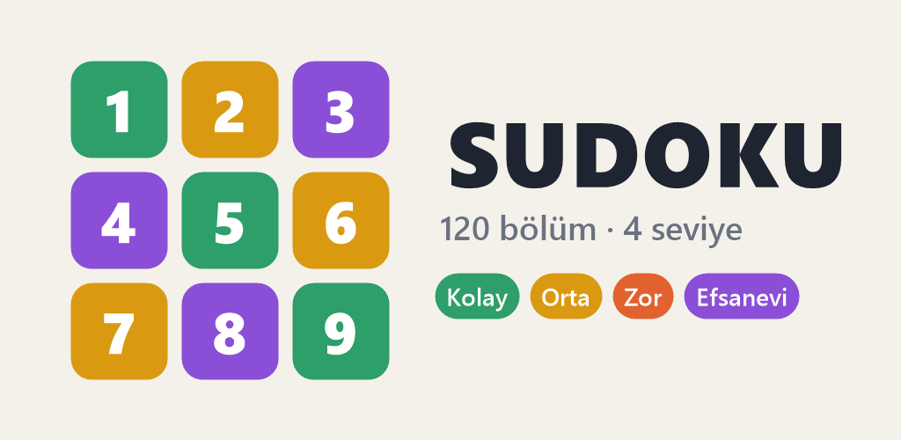
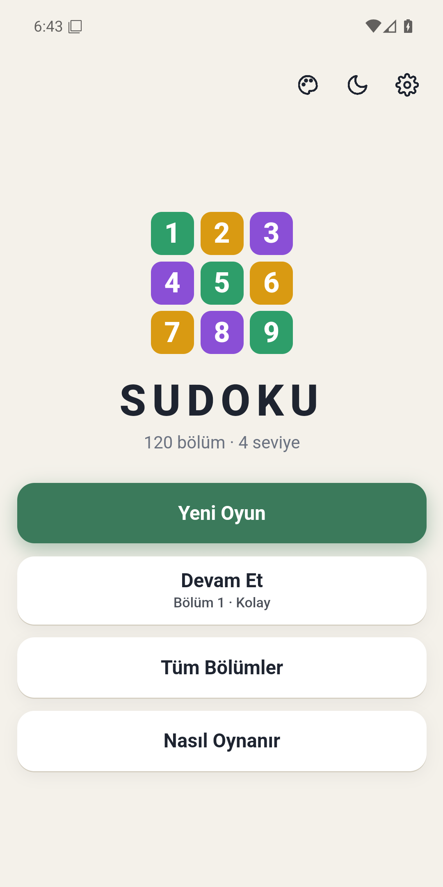
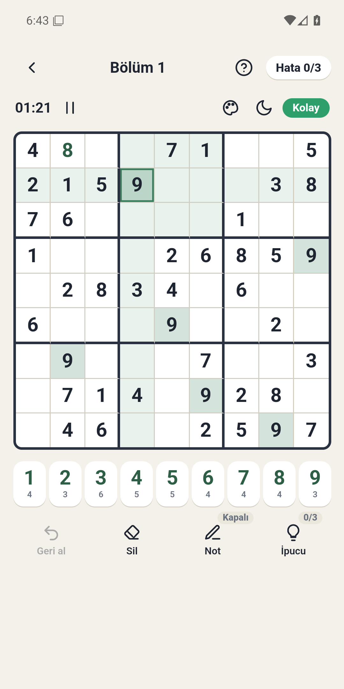
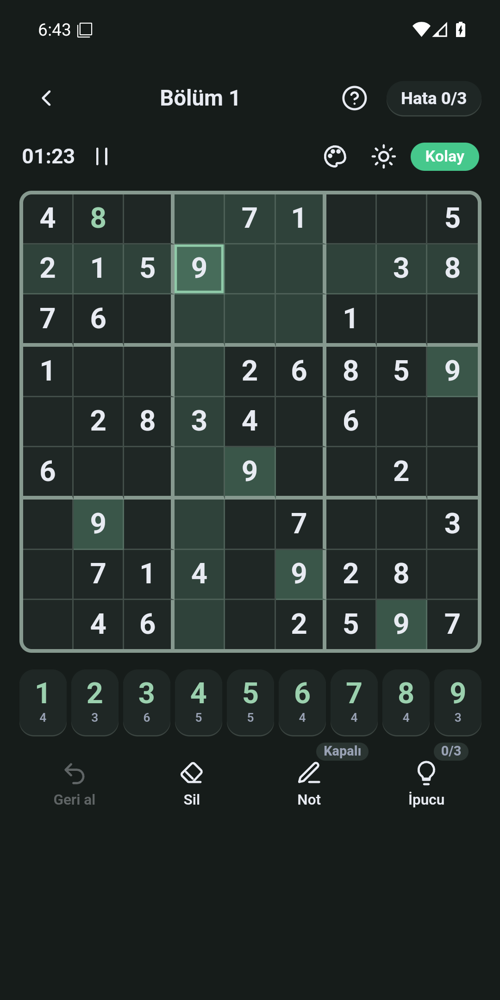
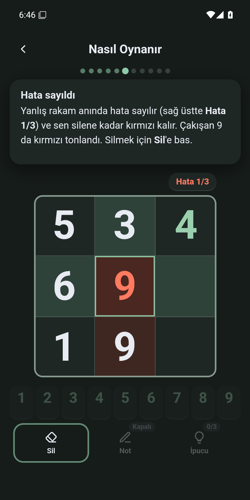
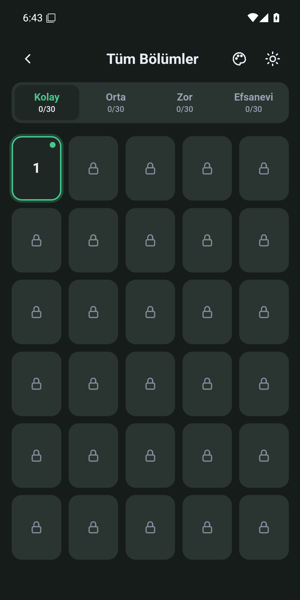
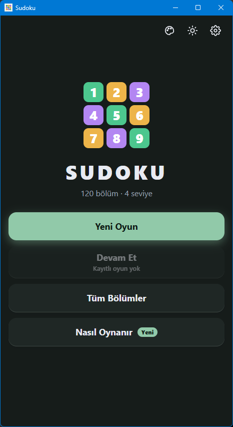

<p align="center">
  
</p>

<h1 align="center">Sudoku</h1>

<p align="center">
  <b>120 bölümlük, tamamen Türkçe, reklamsız ve çevrimdışı Sudoku.</b><br>
  Android telefonda, Windows bilgisayarda ya da doğrudan tarayıcıda oyna.
</p>

<p align="center">
  <a href="https://github.com/mhmtkochan/sudoku/releases/latest"></a>
  
  
  
</p>

---

## İndir

En güncel dosyalar her zaman **[Releases › Son sürüm](https://github.com/mhmtkochan/sudoku/releases/latest)** sayfasındadır.

| Platform | Dosya | Boyut |
|---|---|---|
| 📱 **Android** (8.0 ve üzeri) | [`sudoku-1.0.0.apk`](https://github.com/mhmtkochan/sudoku/releases/latest/download/sudoku-1.0.0.apk) | ~1,9 MB |
| 💻 **Windows** 10 / 11 (64 bit) | [`Sudoku-1.0.0-portable.exe`](https://github.com/mhmtkochan/sudoku/releases/latest/download/Sudoku-1.0.0-portable.exe) | ~105 MB |
| 🌐 **Tarayıcı** | [`web/index.html`](web/index.html) dosyasını indirip çift tıkla | ~0,1 MB |

### Android'e kurulum

1. Telefonundan `sudoku-1.0.0.apk` dosyasını indir.
2. İndirilenler'den dosyaya dokun.
3. İlk kez APK kuruyorsan telefon izin isteyecek: **Ayarlar › Bilinmeyen kaynaklardan yükleme** (bazı telefonlarda *Bilinmeyen uygulamaları yükle*) bölümünden, dosyayı açtığın uygulamaya (Chrome, Dosyalar vb.) izin ver.
4. **Yükle**'ye dokun. Hepsi bu, oyun ana ekranında.

> Uygulama Play Store dışından yüklendiği için Play Protect "tanınmayan uygulama" uyarısı verebilir; **Yine de yükle** diyerek devam edebilirsin. Uygulamanın internet izni bile yoktur.

### Windows'ta çalıştırma

1. `Sudoku-1.0.0-portable.exe` dosyasını indir. Kurulum yok, istediğin klasöre koyabilirsin.
2. Çift tıkla.
3. Exe dijital olarak imzalı olmadığı için **Windows SmartScreen** "Windows bilgisayarınızı korudu" uyarısı gösterebilir. **Ek bilgi › Yine de çalıştır** ile açabilirsin.

> İlk açılış birkaç saniye sürebilir (portable exe kendini geçici klasöre açar). İlerlemen `%APPDATA%\Sudoku` içinde saklanır, exe'yi taşısan da kaybolmaz.

---

## Ekran görüntüleri

<table>
  <tr>
    <td align="center"><br><sub>Ana menü</sub></td>
    <td align="center"><br><sub>Oyun ekranı</sub></td>
    <td align="center"><br><sub>Koyu tema</sub></td>
  </tr>
  <tr>
    <td align="center"><br><sub>Nasıl Oynanır öğreticisi</sub></td>
    <td align="center"><br><sub>Tüm bölümler ve yıldızlar</sub></td>
    <td align="center"><br><sub>Windows sürümü</sub></td>
  </tr>
</table>

---

## Özellikler

- 🧩 **4 seviye × 30 bölüm = 120 bulmaca:** Kolay, Orta, Zor ve Efsanevi. Her bulmacanın tek bir çözümü vardır.
- ❤️ **Hata hakkı:** Kolay 3, Orta 4, Zor 5, Efsanevi 6. Haklar bitince bölüm sona erer.
- 💡 **3 ipucu hakkı:** Takıldığında seçili hücrenin doğru rakamını gösterir.
- ✏️ **Kalem / notlar:** Aday rakamları hücreye küçük notlar olarak yaz.
- ✅ **Tamamla:** Son 8 boş hücre kaldığında tek dokunuşla bulmacayı bitir.
- 🎨 **4 renk paleti × açık / koyu tema:** Sistem temasını takip eder ya da elle seçilir.
- ⏱️ **Süre sayacı ve duraklatma:** Ara verdiğinde süre durur, tahta soluklaşır ve kilitlenir.
- ⭐ **Yıldız sistemi:**
  - ⭐⭐⭐ Hatasız ve ipucusuz
  - ⭐⭐ Toplam en fazla 1 hata ya da ipucu
  - ⭐ Daha fazlası
- 🎓 **İnteraktif "Nasıl Oynanır" öğreticisi:** Kuralları ve kontrolleri adım adım, oynayarak öğretir.
- 💾 **İlerleme cihazda saklanır:** Yarım kalan oyun, açılan bölümler ve yıldızlar kaybolmaz.
- 🔒 **Tamamen çevrimdışı:** İnternet izni yok, reklam yok, hiçbir veri toplanmaz.

---

## Nasıl çalışır?

Oyunun tamamı **tek bir HTML dosyasıdır** (HTML + CSS + JavaScript, 120 bulmaca içine gömülü). Diğer sürümler bu dosyayı olduğu gibi sarar:

```
             web/index.html  (oyunun kendisi, tek dosya)
                    │
       ┌────────────┼─────────────────┐
       ▼            ▼                 ▼
   Tarayıcı    Android (WebView)   Windows (Electron)
               INTERNET izni yok    ağ istekleri engelli
               Java, minSdk 26      portable tek .exe
```

- **Web:** `web/template.html` + `web/sudoku_puzzles.json` → `web/build.ps1` → tek dosyalık `web/index.html`.
- **Android:** Java/Gradle projesi; oyun `assets/index.html` olarak paketlenir ve bir `WebView` içinde açılır. Manifest'te **INTERNET izni yoktur**, ilerleme WebView'in `localStorage`'ında tutulur.
- **Windows:** Electron sarmalayıcı; `sandbox` ve `contextIsolation` açık, menü ve geliştirici araçları kapalı, `file://` dışındaki tüm istekler ve dış bağlantılar engellenir.

---

## Proje yapısı

| Klasör | İçerik |
|---|---|
| [`web/`](web) | Oyunun kaynağı: `template.html`, bulmacalar (`sudoku_puzzles.json`), Python üretim/doğrulama betikleri, derlenmiş `index.html`. [Ayrıntılar](web/README.md) |
| [`android/`](android) | Android uygulaması (Java, Gradle, WebView) ve Play Store görselleri (`store/`). [Ayrıntılar](android/README.md) |
| [`desktop/`](desktop) | Windows masaüstü uygulaması (Electron, portable exe). [Ayrıntılar](desktop/README.md) |
| [`docs/`](docs) | README görselleri |

> 💡 Hiçbir şey kurmadan denemek için [`web/index.html`](web/index.html) dosyasını indirip tarayıcında açman yeterli.

---

## Kendin derle

Tüm betikler PowerShell ile Windows'ta çalışır:

```powershell
# 1) Web: bulmacaları gömerek tek dosyalık web/index.html üretir
powershell -ExecutionPolicy Bypass -File web\build.ps1

# 2) Android: APK/AAB derler (Android SDK + JDK 17 gerekir)
powershell -ExecutionPolicy Bypass -File android\build-apk.ps1 -Refresh -GameSource "$PWD\web\index.html"

# 3) Windows: portable exe derler (Node.js gerekir) -> desktop\dist\
powershell -ExecutionPolicy Bypass -File desktop\build.ps1
```

### Güncelleme akışı

1. `web/template.html` dosyasını düzenle.
2. `web/build.ps1` çalıştır → `web/index.html` üretilir.
3. `android/build-apk.ps1 -Refresh` çalıştır → güncel `index.html` Android projesine kopyalanır ve APK/AAB derlenir.
4. `desktop/build.ps1` çalıştır → güncel oyunla yeni exe üretilir.

> **Not:** `build-apk.ps1` içindeki `-GameSource` parametresinin varsayılanı bu repodaki `web/` klasörünü değil, geliştiricinin bilgisayarındaki yerel web klasörünü gösterir. Bu repodan derlerken yukarıdaki gibi `-GameSource` ile bu repodaki `web\index.html` dosyasının tam yolunu ver.

### Repoda olmayanlar

İmzalama anahtarı ve parolaları (`android/signing/`), derleme çıktıları (`dist/`, `build/`, APK/AAB, exe), `node_modules/` ve `local.properties` bilerek repoya eklenmemiştir. Kendi imzalı Android sürümünü derlemek için kendi keystore dosyanı `android/signing/` altına koyman gerekir.

---

## Gizlilik

Sudoku **hiçbir kişisel veri toplamaz, hiçbir yere veri göndermez.**

- Android uygulaması internet dahil hiçbir izin istemez.
- Windows sürümü ağ isteklerini tamamen engeller.
- Analitik, reklam, hesap ya da çerez yoktur.
- Oyun ilerlemen yalnızca kendi cihazında saklanır (Android'de uygulama verisinde, Windows'ta `%APPDATA%\Sudoku` klasöründe).
